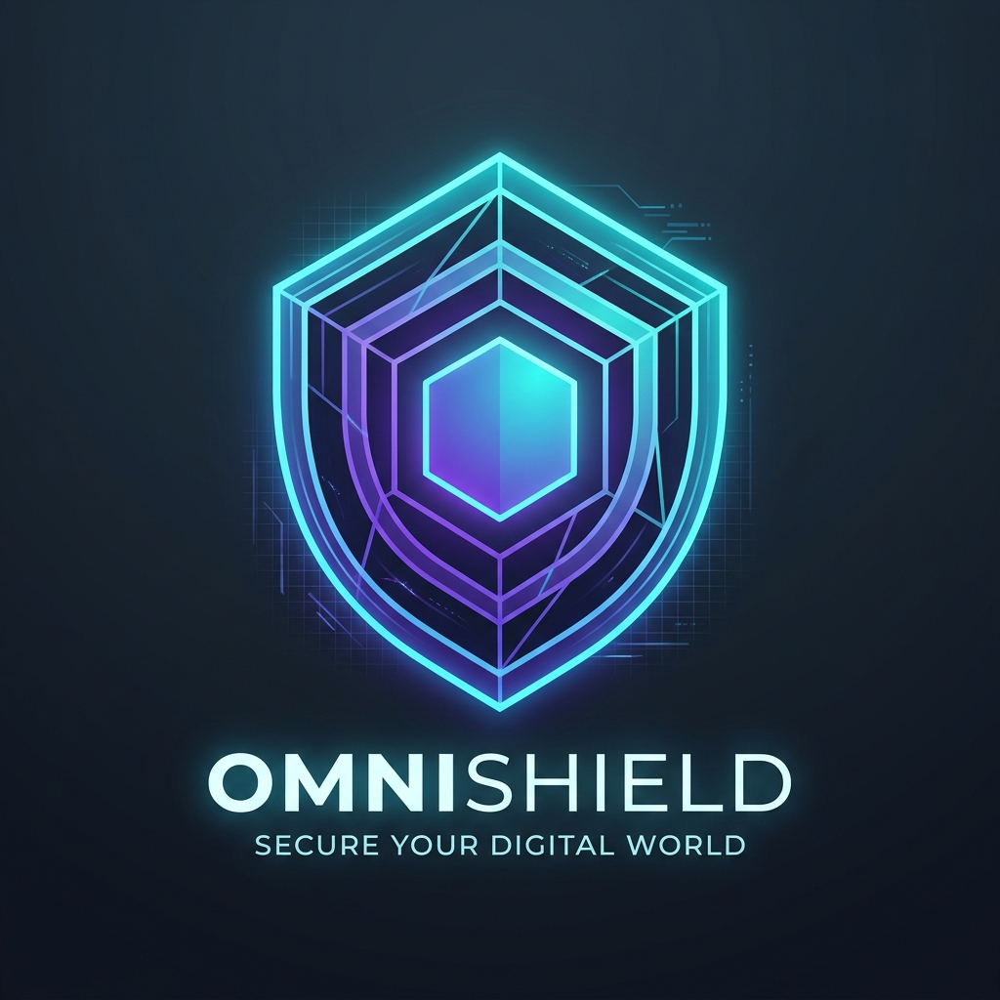
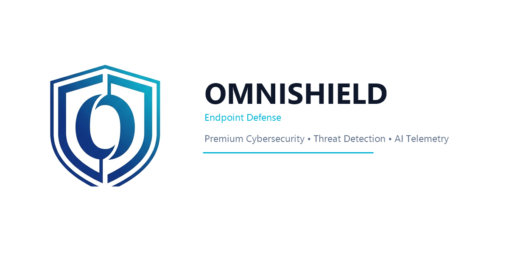

<div align="center">
  <a href="https://github.com/ajaybaniya07/OmniShield">
    
  </a>
  <br/><br/>
  <h1>🛡️ OmniShield 2.0</h1>
  <p><b>Unified Multi-Engine Windows Endpoint Defense & Threat Hunting Platform</b></p>
  <br/>
  
</div>

[-blue.svg?logo=windows)](https://microsoft.com/windows)
[](https://python.org)
[](https://fastapi.tiangolo.com)
[](https://www.nist.gov/cyberframework)
[](https://attack.mitre.org)
[](tests/run_tests.py)
[](#)

> **Enterprise-grade unified endpoint detection, real-time threat hunting, and automated incident containment—built natively for Windows.**  
> No Linux VMs. No Docker containers. No WSL. No cloud telemetry lock-in.

---

## 📋 Table of Contents
- [What is OmniShield?](#-what-is-omnishield)
- [Key Features](#-key-features)
- [How It Works (Architecture)](#-how-it-works-architecture)
- [Detection & Telemetry Engines](#-detection--telemetry-engines)
- [Multi-Factor Risk Scoring Engine](#-multi-factor-risk-scoring-engine)
- [Quick Start Guide](#-quick-start-guide)
- [Repository Structure](#-repository-structure)
- [Automated Testing & Safety Net](#-automated-testing--safety-net)
- [Threat Model & Honest Disclosures](#-threat-model--honest-disclosures)
- [Roadmap](#-roadmap)
- [Licenses & Acknowledgments](#-licenses--acknowledgments)

---

## 🎯 What is OmniShield?

Most modern Security Operations Center (SOC) workstations and endpoint defense suites require heavy virtualization, Linux environments, or third-party cloud agents that send internal data offsite.

**OmniShield** is an open-source, purely native Windows endpoint defense system. It unifies five battle-tested security engines (**Microsoft Sysmon, Sigma rules via Hayabusa, YARA, ClamAV, and osquery**) into a unified local SQLite event bus with a sleek real-time management dashboard running on `http://127.0.0.1:8080`.

It empowers system administrators, security analysts, and enthusiasts to detect active tradecraft, analyze suspicious binaries, monitor baseline drift, and instantly isolate compromised processes with 1-click controls.

---

## ✨ Key Features

| Capability | Description |
| :--- | :--- |
| **Unified Event Bus** | Correlates alerts from Sysmon, Sigma, YARA, ClamAV, and Defender into a single chronologically indexed timeline. |
| **MITRE ATT&CK® Mapping** | Every behavioral trigger is tagged with its MITRE ATT&CK Technique ID (e.g., `T1003`, `T1059.001`, `T1547.001`) with direct documentation links. |
| **NIST CSF 2.0 Compliance** | Built-in **Check My PC** auditor continuously measures your posture against **Identify, Protect, Detect, Respond, and Recover** standards. |
| **Multi-Factor Risk Scoring** | Replaces arbitrary alerts with an intelligent 0–100 score combining Authenticode signatures, Mark-of-the-Web, and Shannon entropy. |
| **1-Click Active Response** | Terminate suspicious process trees, lock binaries using Windows Software Restriction hashes, or isolate outbound network access. |
| **Zero Docker / Zero WSL** | Everything compiles to native Windows services and executables with zero hypervisor overhead. |
| **Privacy First** | 100% of telemetry, logs, and database records remain on your local disk. Mark-of-the-Web query strings are sanitized to scrub private access keys. |

---

## 🏗️ How It Works (Architecture)

```
┌─────────────────────────────────────────────────────────────────────────────────┐
│                           WINDOWS HOST TELEMETRY                                │
│                                                                                 │
│  [Windows Defender / ASR]  [Microsoft Sysmon]  [ClamAV Engine]  [YARA Scanner]  │
│       EventIDs 1116-1122       Process / Net     On-Demand / RT   Stealer Rules │
└───────────────────────┬─────────────────┬──────────────┬───────────────┬────────┘
                        │                 │              │               │
                        ▼                 ▼              ▼               ▼
┌─────────────────────────────────────────────────────────────────────────────────┐
│                       SECURITY CONSOLE REAL-TIME CORE                           │
│                                                                                 │
│   • Hayabusa Sigma Parser (High-sensitivity filter: 0 network false-alarms)     │
│   • osquery Periodic Baseline Difference Engine (Startup, Services, Tasks)      │
│   • WinVerifyTrust Authenticode & Catalog Signature Verifier                    │
│   • Shannon Entropy Analyzer & Unicode Right-to-Left Override (RLO) Detector    │
│   • Decoy Canary Tripwire Engine (with benign indexer allow-listing)            │
│   • Redaction Filter (Scrubs tokens from Zone.Identifier HostUrl/ReferrerUrl)   │
└────────────────────────────────────────┬────────────────────────────────────────┘
                                         │
                                         ▼
┌─────────────────────────────────────────────────────────────────────────────────┐
│                         MULTI-FACTOR RISK SCORER (0 - 100)                      │
│                                                                                 │
│   +100 AV/YARA Match   +70 Critical Sigma   +30 Deceptive Ext / RLO Spoofing    │
│   +25 Unsigned in Temp +15 Internet MOTW    +10 Packed / Encrypted Entropy      │
│   -50 Microsoft Catalog Verified            -30 Trusted Vendor Certificate      │
└────────────────────────────────────────┬────────────────────────────────────────┘
                                         │
                                         ▼
┌─────────────────────────────────────────────────────────────────────────────────┐
│              LOCAL STORAGE & SECURE WEB DASHBOARD (127.0.0.1:8080)              │
│                                                                                 │
│   • SQLite WAL Database (events, exclusions, quarantined items, mutes)          │
│   • ACL-Restricted Bootstrap Token (Only SYSTEM and Administrators)             │
│   • CSP & Security Guard Middleware (X-Frame-Options: DENY, SameSite Cookie)    │
│   • 1-Click Process Termination & Windows Firewall Outbound Isolation           │
└─────────────────────────────────────────────────────────────────────────────────┘
```

---

## 🔍 Detection & Telemetry Engines

1. **Hayabusa & Sigma Rules (Behavioral Analysis)**
   - Correlates Windows Event Logs and Sysmon in real-time.
   - Detects PowerShell obfuscation, lateral movement, LOLBins (`rundll32`, `certutil`), and credential dumping.
2. **YARA Pattern Matching**
   - High-fidelity signatures targeting infostealers (**RedLine, Vidar, LummaC2**), ransomware volume shadow deletion (`vssadmin`), and webshells.
3. **ClamAV (Antivirus Engine)**
   - Scans files on-demand or in real-time with automated signature updates via FreshClam.
4. **osquery (State & Persistence Auditing)**
   - Continuous differential queries monitoring Registry `Run` keys, active services, scheduled tasks, listening ports, and `hosts` file tampering.
5. **Windows Defender & Exploit Guard ASR Integration**
   - Real-time ingestion of Defender detection (Event 1116), remediation actions (Event 1117), and Attack Surface Reduction blocks (Event 1121).

---

## 🧮 Multi-Factor Risk Scoring Engine

Rather than inundating analysts with generic alerts, OmniShield evaluates alerts through an algorithmic multi-factor scoring pipeline:

| Factor | Points | Description |
| :--- | :---: | :--- |
| **Known Malware Signature** | `+100` | Matched known malicious signature via ClamAV or YARA. |
| **High Severity Behavioral Event** | `+70` | Critical Sigma rule trigger (e.g. LSASS memory read). |
| **Deceptive Extension / Unicode RLO** | `+30` | Masquerading techniques like `Report.pdf.exe` or unicode spoofing. |
| **Unsigned Binary in Temp/Downloads** | `+25` | Executable running outside standard Program Files without signature. |
| **Downloaded from Internet (MOTW)** | `+15` | File tagged with `ZoneId: 3` (Mark-of-the-Web). |
| **High Shannon Entropy (Packed)** | `+10` | Binary entropy $\ge 7.2 / 8.0$, indicating crypters or ransomware. |
| **Trusted Vendor Signature** | `-30` | Valid third-party digital certificate verified via `WinVerifyTrust`. |
| **Microsoft System Binary** | `-50` | Authentic Windows component signed via OS catalog database. |

---

## 🚀 Quick Start Guide

### System Requirements
- **OS:** Windows 10 or Windows 11 (64-bit).
- **Privileges:** Administrator permissions (for Sysmon and service installations).
- **RAM / Storage:** 4 GB RAM, 2 GB free disk space.

### Single-Step Unified Setup
1. Download or clone this repository to a short path:
   ```cmd
   git clone https://github.com/ajaybaniya07/OmniShield.git C:\Build\OmniShield
   cd C:\Build\OmniShield
   ```
2. Right-click **`INSTALL.bat`** and select **Run as Administrator** (or double-click and accept the UAC prompt).  
   *The installer automatically fetches security binaries, configures ClamAV and Sysmon, binds all add-ons, and compiles the native service.*
3. Launch the console:
   Double-click **`START OmniShield.bat`** or use the desktop shortcut.
4. Access the dashboard in your browser:
   **[http://127.0.0.1:8080](http://127.0.0.1:8080)**

### Utility Scripts Reference

| Script | Purpose |
| :--- | :--- |
| **`INSTALL.bat`** | **Unified Installer:** Installs Core engines + all Add-ons in one automated pass. |
| **`START OmniShield.bat`** | Launches the background service and opens the web console. |
| **`INSTALL-ADDON.bat`** | Re-syncs or updates add-on scripts without running a full engine reinstall. |
| **`UPDATE.bat`** | Rebuilds `backend.exe` while strictly preserving your alerts, settings, and mutes. |
| **`FIX-ClamAV.bat`** | Diagnostic helper to reinstall or repair ClamAV daemon services. |
| **`UNINSTALL.bat`** | Cleanly removes background tasks, Windows services, and program files. |

---

## 📂 Repository Structure

```
OmniShield/
├── backend/                  # Python 3.12 / FastAPI Core Engine
│   ├── main.py               # Core orchestrator, API endpoints, risk scorer & security middleware
│   ├── addon_reports.py      # NIST CSF 2.0 posture engine & user activity auditing
│   ├── addon_vt.py           # VirusTotal quota-guarded intelligence lookup (opt-in)
│   └── requirements.txt      # Production package dependencies
├── config/                   # Configuration Templates
│   ├── console.json          # Main engine thresholds, scan batching, & exclusions
│   ├── clamd.conf            # ClamAV daemon configuration
│   └── freshclam.conf        # Antivirus update definitions configuration
├── installer/                # Automated Setup Scripts
│   ├── setup-all.ps1         # Master PowerShell installer & builder
│   ├── apply-addon.ps1       # Automated add-on connector
│   └── get-payload.ps1       # Secure engine downloader & checksum verifier
├── rules/                    # Detection Rulesets
│   └── yara/
│       ├── production_rules.yar # Infostealers, ransomware, webshells, & tampering rules
│       └── index.yar         # Master YARA rule manifest
├── tests/                    # Robustness & Safety Net
│   └── run_tests.py          # Unit test suite & parser fuzzing verification
├── ui/                       # Modern Dark-Mode Web Dashboard
│   ├── index.html            # Core SPA interface
│   ├── logo.svg / logo.png   # Scalable vector & high-res shield logo
│   ├── banner.svg / .png     # High-resolution platform banner
│   ├── addon.js / addon.css  # Reports & NIST CSF 2.0 UI components
│   └── addon_vt.js / .css    # VirusTotal modal & enrichment drawers
└── README.md                 # Project documentation
```

---

## 🧪 Automated Testing & Safety Net

OmniShield includes an automated fuzzing and resilience test suite verifying that all input parsers (Mark-of-the-Web streams, Unicode filenames, PE entropy calculators, and auth codes) handle corrupted or hostile data without crashing the backend service.

To run the automated suite:
```cmd
python tests/run_tests.py
```

### Test Coverage Matrix
- `test_analyze_pe_heuristics`: Validates entropy calculation, deceptive double extensions, and Unicode RLO override spoofing.
- `test_auth_code_requires_bootstrap_token`: Verifies that unauthorized local processes cannot obtain session tokens.
- `test_authenticode_edge_cases`: Validates WinVerifyTrust catalog signature detection against Windows system binaries.
- `test_motw_sanitization`: Verifies regex stripping of secrets from `Zone.Identifier` URLs.
- `test_risk_score_calculation`: Tests weighted algorithm point assignments and trusted discounts.
- `test_eicar_presence_in_self_test`: Confirms safe EICAR antivirus verification.
- `test_infostealer_rules_presence`: Confirms compilation of RedLine, Vidar, and LummaC2 YARA patterns.

---

## 🛡️ Threat Model & Honest Disclosures

OmniShield is designed with honest security engineering principles:

### What OmniShield DOES:
- Provides immediate visibility across Windows event logs, process executions, and network behaviors.
- Maps adversary actions to MITRE ATT&CK techniques in real time.
- Gives defenders 1-click tools to terminate processes, hash-lock binaries, and block malicious IPs.
- Protects its own local REST API using ACL-restricted tokens, CSRF tokens, strict host headers, and Content Security Policy.

### What OmniShield CANNOT Do (Keep Microsoft Defender ON):
- **No Kernel Driver (User-Space Operation):** OmniShield runs as a standard Windows service with `SYSTEM` privileges. It does not install a proprietary kernel driver (ELAM or minifilter). It terminates threats within seconds of execution, but cannot intercept file execution in pre-boot kernel space. **Always keep Microsoft Defender active for kernel-level protection.**
- **Administrator-Level Compromise:** If an attacker already possesses Administrator or `NT AUTHORITY\SYSTEM` privileges, they can terminate user-mode processes.

### Data Privacy:
- **Zero Cloud Telemetry:** No user data, file paths, or event logs leave your computer.
- **VirusTotal (Opt-In Only):** If you configure a VirusTotal API key, only file SHA-256 hashes (and optionally sanitized URLs) are sent for threat lookup. Sensitive query parameters (`token=`, `auth=`) are stripped before transmission.

---

## 🗺️ Roadmap

- [x] **Unified Installer:** Single-click combined Core + Add-ons deployment (`INSTALL.bat`).
- [x] **NIST CSF 2.0 Alignment:** Interactive posture audit across Identify, Protect, Detect, Respond, and Recover.
- [x] **Infostealer YARA Expansions:** Signatures for RedLine, Vidar, and LummaC2.
- [x] **Authenticated Launcher Handshake:** Token-protected `/api/auth/code` with Windows ACL restriction.
- [ ] **YARA-Forge Automation:** Scheduled pulling of vetted community rules with automatic rule license auditing.
- [ ] **Remote Signed Manifests:** Cryptographic signature verification for automated updates over HTTPS.
- [ ] **AppLocker / SRP Policy Integration:** Native pre-execution binary execution locking.

---

## 📜 Licenses & Acknowledgments

OmniShield orchestrates premier open-source detection tools. All credit to their respective authors:

| Component | Author / Project | License |
| :--- | :--- | :--- |
| **ClamAV** | Cisco Talos | GPLv2 |
| **Hayabusa** | Yamato Security | AGPLv3 |
| **osquery** | The Linux Foundation / osquery Project | Apache 2.0 |
| **YARA** | VirusTotal | BSD-3-Clause |
| **Sysmon** | Mark Russinovich / Microsoft Sysinternals | Sysinternals License |
| **Sigma Rules** | SigmaHQ | Detection Rule License (DRL 1.1) |
| **Inter Font** | Rasmus Andersson | SIL Open Font License 1.1 |
| **FastAPI / Uvicorn** | Sebastián Ramírez | MIT License |

---

*Built with ❤️ for the cybersecurity, blue team, and incident response community.*
